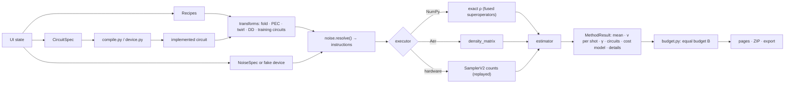

# QEM Explorer — architecture

QEM Explorer is a Streamlit multipage application built around one rule: **every page is a thin view over a
small, tested engine.** The engine (`qemx/`) knows nothing about Streamlit, so the same code runs in the app, in
the tests, on IBM hardware replays and inside the scripts the app exports.

## 1. Directory structure

```
qem-explorer/
├── app.py                        Home: the trade-off in one equation, a live demo, the method map
├── pages/
│   ├── 1_Playground.py           Build · Circuits · Time travel · Mitigate & compare · Export
│   ├── 2_Cost_vs_Precision.py    RMSE(B), budget/QPU time for ε, crossover B*, PEC wall (curve + map), depth sweep
│   ├── 3_Bias_Variance.py        Bullseye of repeated experiments in two observables
│   ├── 4_Model_Mismatch.py       Assumed vs true PEC rate (curve + map), readout drift, unmodeled noise
│   ├── 5_Head_to_Head.py         N contenders over a noise parameter; winner map over (parameter, shots)
│   ├── 6_Theory.py               docs/theory.md (the research handbook): five parts, contents column, diagrams,
│   │                             search and calculators
│   ├── 7_IBM_Quantum.py          Local rehearsal on a fake device, then real hardware (token in a password field);
│   │                             the results view and ZIP are the Playground's (ui/results.py)
│   ├── 8_Batch_Run.py            algorithms × methods × noise × scales × simulators, one Run-all button
│   └── 9_Learn.py                guides (one-click setups), fundamentals, algorithm walkthroughs, research topics
│                                 (docs/learn/*.md)
├── qemx/                         The engine (no Streamlit imports)
│   ├── circuit.py                Op, CircuitSpec, gate table, safe expression reader, text parser, Qiskit I/O
│   ├── templates.py              Template families (basics, algorithms, NISQ variational, QEC, deep FTQC);
│   │                             parameter schemas (TParam), CATEGORIES, a small statevector for VQE/QAOA angles
│   ├── observables.py            Diagonal observables: Z strings, projectors, magnetization, custom vectors
│   ├── hamiltonian.py            Pauli-sum parser (no eval), qubit-wise commuting settings, exact combination
│   ├── noise.py                  NoiseSpec, presets, channels; resolve(): circuit + noise → instruction list
│   ├── compile.py                prep → circuit → basis change → (ISA, lattice or device transpile) → measurement map
│   ├── stages.py                 logical → routed → native stages with provenance; the aligned logical/physical diff
│   ├── layout_search.py          device calibration, VF2 placements of the compiled circuit, expected success F
│   ├── device.py                 Fake IBM devices: target filtering, compilation, ALAP schedule, Aer noise model
│   ├── backends/
│   │   ├── numpy_dm.py           Exact density matrix; per-step superoperator fusion; non-CP maps for PEC means
│   │   └── aer.py                Qiskit Aer density_matrix executor of the same instruction list
│   ├── engine.py                 simulate(): resolve, execute, average field samples, readout; Bloch, fidelity
│   ├── transforms.py             Folding, Clifford replacement (training circuits), twirl and DD instances
│   ├── methods/                  base (Param with visibility conditions, Recipe, Runner, Context, readout/twirl/DD
│   │                             options, M3, calibration draws) · raw · zne · pec · learning (CDR, FR) ·
│   │                             nil (neighbor-informed learning, certified regression solvers) · symmetry · vd ·
│   │                             compose (chains: an outer ZNE/CDR/NIL over an inner raw/symmetry/VD/PEC)
│   ├── qec.py                    small stabilizer codes as data and benchmark algorithms compiled onto them
│   │                             (the "Encoded algorithm" template and its presets)
│   ├── phase/                    Direction A pipeline: manifests, cell runner, equal-budget ledger (exact integer
│   │                             allocations, training levels with b, u, v, w), Monte-Carlo validation, records,
│   │                             collect (tables), runner (resumable, one manifest per output directory)
│   ├── recipes.py                Recipe presets, compare() (unique titles), equal-budget summary rows, table_rows()
│   ├── budget.py                 Equal-budget accounting: B = N_t + F + c·s, optimal s*, Var = v/N_t + w/s + u,
│   │                             RMSE(B), budget for ε, crossover, the circuits each method sends, draws at B
│   ├── analysis.py               RMSE model per row, PEC wall, sweeps, mismatch maps, winner maps
│   ├── report.py                 Cross-page results of one comparison (cost & precision, PEC wall, bias–variance)
│   │                             for the global ZIP
│   ├── insight.py                the analysis engine: view profile (distribution / expectation / QEC / diagnostics),
│   │                             exact ideal, noisy, readout-corrected and ZNE-extrapolated distributions, syndromes
│   ├── variational.py            live parameters of VQE/QAOA, landscape scans
│   ├── batch.py                  batch plans and runs (per-scenario isolation), winners
│   ├── sweep.py                  sweep syntax (inputs, ramp:k, bases, template and noise parameters), variants
│   ├── learn.py                  chapters, research topics, guides and one-click setups (the Playground or an
│   │                             analysis page with whitelisted controls preset; applied by ui.state.apply_setup)
│   ├── timeline.py               Step-by-step states (compact mode for many qubits)
│   ├── hardware.py               record → allocate (the budget model) → execute (SamplerV2) → replay; returns the
│   │                             simulator's result structure
│   ├── divergence.py             application suite on a device against its component models: plan (best chains,
│   │                             as-executed circuits, equal budgets), predictors (per-gate depolarizing, Chen et
│   │                             al.'s median model, full device model), emulation with injected noise (crosstalk,
│   │                             scale, coherent, t2, hotspot), Fc / normalized fidelity at the same shots, layout /
│   │                             twirl / seed variants, aggregation and plurality vote rows, the folding fingerprint
│   │                             (fold_response, pooled_anomaly) (I/O-free)
│   ├── context_noise.py          context features of an as-executed circuit (ALAP schedule, spectators, parallel
│   │                             adjacent gates, idle time, calibrated error), Chen et al.'s plurality vote, weighted
│   │                             NNLS attribution (divergence budget, per-qubit), heavy-hex drawing coordinates
│   ├── export.py                 Standalone script (terminal + Jupyter entry point) with the engine inlined
│   ├── bundle.py                 "Download all" ZIP: CSV/LaTeX tables in sub-folders, PNG/SVG figures (Plotly JSON
│   │                             without a renderer; never HTML), state, script
│   ├── resources.py              Memory estimates, cooperative deadline, readable errors, secret scrubbing
│   ├── explain.py                "Why this happens?" texts (TeX)
│   └── viz/                      theme, composer (collision-free columns, stacked diff, gate-only time cursor),
│                                 states (Bloch grid, projections, density, landscapes), charts (incl. histograms,
│                                 syndromes, logical error), analysis_charts, batch_charts, topology
├── ui/
│   ├── state.py                  Session-state schema, key-only persistent widgets, callbacks, JSON validation
│   ├── widgets.py                Typed-number sliders, method forms, guarded execution, Markdown escaping
│   ├── composer_dnd.py (+ composer_assets/)  Drag-and-drop composer (components v2); every edit validated in Python;
│   │                             input preparation and basis changes drawn as locked boxes
│   ├── results.py                The results view of a comparison (figures, analysis views, cost table, internals,
│   │                             Download all), shared by the Playground and the IBM Quantum page
│   ├── tooltips.py               plain(): TeX in help texts → Unicode math; install() patches every widget once
│   ├── figures.py                <!-- fig:name --> markers in Markdown → diagrams on a light card
│   ├── sidebar.py · nav.py · cache.py · common.py
├── scripts/make_figures.py       quantikz → PDF → SVG for docs/figures (pdflatex, pdftocairo)
├── scripts/dirA_io.py            input/output of the analysis scripts: sources (run directory, memory), reports,
│                                 report and figure sinks — the computations below never open a file
├── scripts/dirA_checks.py        acceptance checks and summary tables of a run (run_checks → Report)
├── scripts/dirA_figures.py       phase maps, family maps, RMSE and B*(ε) curves (make_figures → a figure sink)
├── scripts/dirA_nil.py           NIL regression rules and NIL against the other methods (analyse → Report)
├── scripts/dirA_zne_folding.py   global against local folding: λ_eff, depths, exact crossover budgets, crossover
│                                 maps; fractional ZNE: equal-budget summary, λ_LC regime, subset noise (analyse →
│                                 Report, make_figures → a figure sink)
├── scripts/dirA_divergence.py    hardware against component-model divergence: plan / run-ibm / collect-ibm /
│                                 run-local / emulate / analyze / recovery / figures (the only place that holds an
│                                 IBM credential, in a local variable); χ² ladder, divergence budget, fingerprint and
│                                 probe tables; difference volumetric plots, budget, fingerprint, heavy-hex map,
│                                 probes and the diagnostic matrix via dirA_figures
├── tests/                        engine, methods, new modules, UI (AppTest), export, rounds 3–5, v1.2 conformance
└── docs/ARCHITECTURE.md · docs/theory.md · docs/learn/ · docs/figures/
```

## 2. Data flow



Key decisions:

1. **One noise resolution, many executors.** `noise.resolve()` produces the instruction list that both simulators
   execute; tests check that they agree to machine precision. The NumPy executor fuses the instructions of each
   circuit step into one superoperator (exact; a 7-qubit Shor circuit went from 58 s to 2.5 s).
2. **Snapshots for time travel.** A run can store ρ (or, for many qubits, per-qubit summaries) after every step;
   scrubbing only indexes them.
3. **Methods are plug-ins** with a parameter schema; the UI builds controls from it.
4. **Exact means, modeled shot noise.** Means come from exact probabilities; shot noise from a variance model and
   multinomial resampling. Bias and variance are therefore separable.
5. **Equal budgets.** Every method is costed at the same total budget B = N_t + F + c·s (`qemx/budget.py`); the
   same allocation drives the cost table, the RMSE curves, the repeated experiments and the hardware plan, so the
   comparison is an exact control experiment.
6. **Deterministic training sets.** The learning method chooses its training circuits from classical ideal values
   only (adaptive spread check), so a hardware run records and replays exactly the same circuits.
7. **State never resets.** Widgets are key-only with `persist_state="session"`, initialized once; model updates go
   through `on_change` callbacks; tabs are stateful. Page switches and reruns keep every value.

## 3. Contracts

```python
Op(name, qubits, params=(), kind="gate" | "noise" | "barrier", tag="")
CircuitSpec(n, ops, name)                                    # hashable, JSON round trip
Template(spec, observable, tex, notes, symmetry, relabel)    # templates.build(key, params)
NoiseSpec(p1, p2, amp_damp, phase_damp, over_rot, zz_phase, kick, field_sigma, idle_dephase, idle_damp,
          ro01, ro10, field_samples)
QEMMethod.run(ctx, **params) -> MethodResult(mean, var1, circuits, fixed_shots, train_circuits, cal_circuits,
                                             cal_grad, cal_theta, shots_per_circuit, var_fixed, gamma,
                                             extra_qubits, accept, implemented, details, notes, sampler)
budget.account(result, B, randomized_target, alloc=None) -> target/training/calibration shots, sd, circuits
compare(compiled, noise, observable, recipes, backend, shots, symmetry) -> (ideal, [Outcome], runner)
summary(outcome, ideal, B, t_shot_us, samples, alloc=None) -> table row (… "status"; hidden cost-model fields)
hardware.make_plan(compiled, observable, recipes, B, …) -> Plan;  hardware.analyze(plan, freqs) -> result dict
```

## 4. Safety and robustness

* Execution: `widgets.guarded()` wraps every heavy call (deadline, `MemoryError`, any exception → `st.error`).
* Input: whitelist AST for expressions, a fixed gate vocabulary for text, validated JSON state files, sanitized
  labels, Markdown escaping of user/exception text, size limits on uploads and pasted text.
* Secrets: the IBM token lives only inside the submit callback, is removed from the session afterwards, is
  excluded from scripts/JSON/ZIP, and is scrubbed from error messages.

## 5. The analysis engine (`qemx/insight.py`)

Results are read through the view that matches their mathematics, decided in two steps.

1. **Profile.** `profile(template, params, custom, observable, estimators, n, logical)` classifies the observable
   (projector with values 0/1 → *distribution*; ±1 parity or a Hamiltonian → *expectation*; the logical observable of
   a QEC template in its own bit order → *QEC*), puts *method diagnostics* second when a selected method has a
   characteristic curve, and returns the reasons shown next to the view selector. The inputs are snapshotted when
   **Run simulation** finishes, so a stored result is always read as it was run.
2. **Data.** `distributions(compiled, noise, outs, runner)` reuses the comparison's memoized simulations and the
   estimators' own calibration to produce exact ideal, noisy, readout-corrected and ZNE-extrapolated distributions.
   Because readout mitigation and linear ZNE act outcome by outcome, the observable summed over a mitigated
   distribution reproduces that method's estimate exactly (a tested invariant). Distributions are marginalized onto
   the bits the observable reads; QEC syndromes are parities of the template's checks.

The page (`analysis_panel` in `pages/1_Playground.py`) renders the chosen view — histogram, estimates ± σ with the
spread of repeated experiments, logical error and syndromes, or a grid of per-method diagnostic cards — and the
same figures go into the Download-all ZIP.

## 6. Threads and Qiskit

Streamlit runs every browser session in its own thread. Qiskit's compiled extensions are therefore entered through
functions decorated with `resources.qiskit_serial`, which hold one process-wide re-entrant lock
(`resources.QISKIT_LOCK`): compilation and routing, circuit construction, device noise models, Aer execution,
template synthesis and the Qiskit drawer. The NumPy simulator does not need the lock and runs in parallel.
`.streamlit/config.toml` sets `runner.fastReruns = false`, so an interrupted run of a session ends before the next
one begins.

## 7. Composition of methods (v1.4)

Mitigation acts at three levels, and the recipe composes them:

1. **circuit transforms** (Pauli twirling / randomized compiling, dynamical decoupling) change every circuit that is
   run (`Recipe.twirl`, `Recipe.dd`);
2. **readout mitigation** acts on every measured distribution (`Recipe.readout`, `Context.mitigate`, `o_eff`);
3. **estimators** turn circuits into an estimate. An estimator is either *per-circuit* (raw, symmetry verification,
   PEC, VD: one circuit's shots → its mitigated value) or *combining* (ZNE, CDR, NIL: several circuits → one value).

The `chain` estimator (`qemx/methods/compose.py`) composes the two kinds: an outer combining estimator runs its
circuits through an inner per-circuit estimator (`_Inner`: the inner method on a copy of the context whose
implemented circuit is the folded copy, training circuit or neighbor). The inner method's `MethodResult` is the
interface — mean, per-shot variance, cost fields, finite-shot `sampler` and `cal_fun` — so the outer method needs no
knowledge of the inner one, and the equal-budget accounting composes exactly (target split by the inner per-shot
standard deviations, training shots spent on the inner method, effective acceptance for the post-selection minimum).
Parameters of the components are copied into the chain's schema with a prefix and visibility conditions
(`Param.when`), so the UI and the manifest checks validate them like any method's. `chain(zne, raw)` and
`chain(nil, raw)` reproduce `zne` and `nil` exactly (tests/test_compose.py).

## 8. The Direction A pipeline and its analysis (v1.4)

`qemx.phase` runs manifests of cells (circuit × device × noise scale × readout × methods), writes one JSON record per
cell (schema `qemx.phase.cell/2`), and `collect` turns the records of the run's manifest into tables (stale records
of an earlier manifest are reported, not used; every table is rewritten). The analysis scripts read those tables
through a *source*, compute on DataFrames, and hand text and figures to *sinks* (`scripts/dirA_io.py`):

```
DirectorySource / MemorySource  →  Run / Tables  →  run_checks · make_figures · analyse  →  Report / figures
                                                                                             →  DirectoryReportSink
                                                                                             →  DirectoryFigureSink
```

