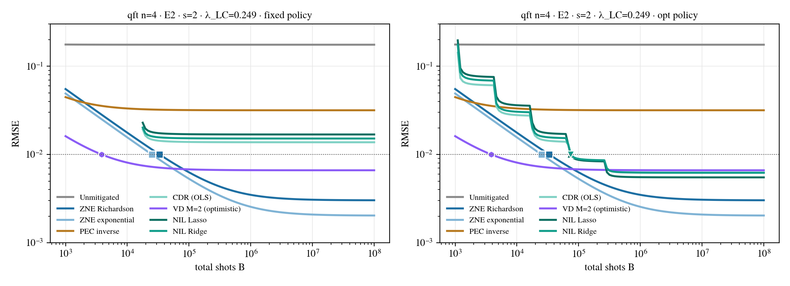
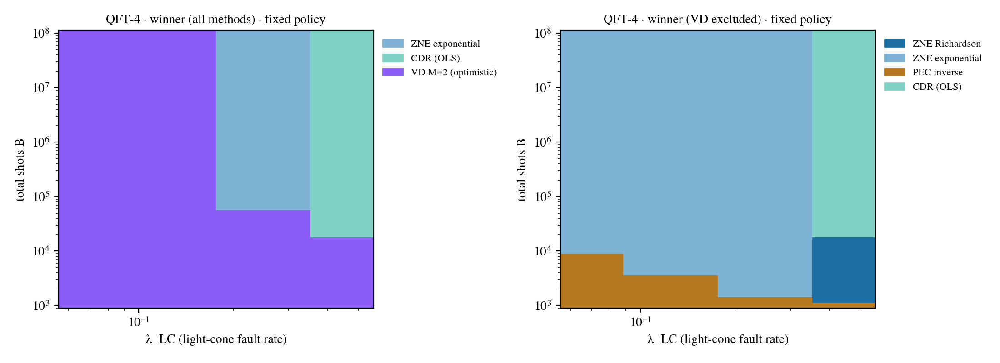

> **Status (1.5.1).** The pre-registered design of the v1 equal-budget phase-diagram study (written for v1.3), kept as
> research documentation: `manifests/direction_A_v1.yaml` and `docs/research/direction_A_v1_cells.csv` still
> define that study. The current main study is described in `docs/USER_GUIDE.md` (manifests `direction_A_v2_*`), its
> final holdout in `docs/FINAL_HOLDOUT.md`. Record schemas and the ledger have evolved since (`docs/MIGRATION.md`).

# 0 · Summary

This document covers the three tasks of the request. Everything it describes is implemented, tested and runnable.

| Task | Where | Deliverable |
|---|---|---|
| 1 · Experimental design | §1 | The estimand, the ledger, the λ axis, the noise engines, the circuits, the methods, the budget axis and the validation design |
| 2 · Pipeline and self-audit | §2 | The `qemx.phase` package (12 modules, no Streamlit), the exact device engine `qemx/device_exact.py` and the record schema. §2.5 has the three-expert self-audit; 41 new tests, 368 tests passing in total |
| 3 · Data-collection manifest | §3 | `manifests/direction_A_v1.yaml` (pre-registered, 1,705 cells in 7 stages) and `direction_A_v1_cells.csv`, one row per cell with its compiled circuit and its λ_LC computed in advance |

**Run it.** `python -m qemx.phase.run run manifests/direction_A_v1.yaml --out data/dirA_v1 --workers 8`, then `… collect data/dirA_v1`.

## Where the design goes beyond the brief

1. **An exact fake-device engine (E2).** `eng=exact` replays Aer's fake-device model (native gates, ALAP schedule, relaxation in every idle window, the gate errors of `basic_device_gate_errors`) with superoperators. It reproduces Aer to ≤ 5·10⁻⁹. It also applies *signed* quasi-probability maps. As a result PEC's bias on a fake device is exact, not a Monte Carlo estimate over 64 sampled instances.
2. **Measured, not modeled, training noise.** For CDR and NIL, the bias b(s_tr), the variance u(s_tr) and the target variance v(s_tr) = E_c[v(c)] come from Monte Carlo at five training levels. Two facts force this:
   - A regression on noisy features is biased (errors-in-variables attenuation).
   - v1.2's first-order training variance is invalid for the Lasso: it was 10³× too large in a test cell.

   With the measured levels, Var = v(s_tr)/N_t + u(s_tr) is exact (law of total variance).
3. **Two training policies.** *fixed* runs the protocol as specified: 16 × 1,024 training shots. *opt* chooses the training shots per budget. This separates "learning is expensive" from "this training protocol is expensive".
4. **Exact fault-probability scaling.** Every channel's fault probability is multiplied by exactly s, so coherent angles scale like √s, not like s. λ_LC is always measured, never assumed. The λ_LC definition also restricts each fault to the Pauli components that act on light-cone qubits.
5. **A coherent-error axis at fixed λ (E1).** Fake devices have no coherent errors. Without this axis the phase diagram would be biased toward methods that assume incoherent noise. E1 is the same fake device homogenized to the chain's medians and run on the same schedule, with a fraction χ ∈ {0, 0.25, 0.5} of each gate's non-relaxation error made coherent. Every gate infidelity is unchanged, so λ is identical for every χ (tested), and λ_LC within a few percent: χ varies the *coherence* of the noise at fixed λ.
6. **Pre-registration and checks that fail loudly.** The manifest hash is stored, and the record schema is versioned. The integer budget identity is asserted on every allocation. Folds are guarded after transpilation. Validation is a stratified Monte Carlo check whose z-scores are tested against N(0, 1).

## Errors found in v1.2 that affect earlier results

These are fixed in v1.3, with regression tests.

| # | Error | Affected | Size |
|---|---|---|---|
| V1 | Tensored and M3 readout mitigation applied qubit *i*'s confusion matrix to classical bit *i*. The calibration circuits were measured through the identity map, so this is wrong whenever routing or relabeling permutes the bits. The hardware path (`HardwareContext`) had the same error for tensored *and* TREX. | Simulated device runs and IBM-hardware runs of the app with readout mitigation and a permuted measurement map | 2.5–3.7·10⁻³ bias, independent of λ, on n=6 fake_fez chains (measured with gate noise off). This is larger than the pre-registered ε = 0.005 when combined |
| V2 | The delta-method training variance of the Lasso differentiates the closed-form fit on its active set. With 22 features and 16 training circuits that set is rank-deficient, so the derivative is meaningless. | NIL-Lasso `u_train` in v1.2's cost table | u = 1.15 against a Monte Carlo value of 0.0013 (QFT-4, fake_fez). Ridge and OLS agree within 10 % |
| V3 | ZNE's sampler rounded the per-circuit shots, so Σ N_j ≠ N. | Monte Carlo draws of ZNE | ±1–2 shots |
| V4 | On the device engine, DD pulses were placed before a qubit's first gate (IBM's `skip_reset_qubits` default does not). | Device runs with DD | Small |
| V5 | A Pauli-sum Hamiltonian that is a multiple of the identity returned `train_circuits = 1.0` (positional-argument slip). | Edge case | — |

**Re-check any earlier app result that used tensored, M3 or TREX readout mitigation together with a non-identity measurement map** (QFT with `relabel`, or any routed circuit). Your own notebooks are affected only if they used `qemx`'s calibration code.

# 1 · Experimental design (Task 1)

## 1.1 Question, estimand and hypotheses

**Question.** For a given circuit family and noise strength, which QEM method gives the smallest error *at the same total number of shots*, and where are the phase boundaries in the plane of light-cone fault rate λ_LC against total shot budget B?

**Estimand.** The estimand is per cell and per method:

$$\mathrm{RMSE}_i(B)=\sqrt{\,b_i^2+\frac{v_i}{N_t}+\frac{w_i}{s}+u_i\,},\qquad B=N_t+T_i\,s_{\rm tr}+c_i\,s,$$

with the optimal integer split of B (§1.2).

**Phase diagram.** The winner map is $\arg\min_i\mathrm{RMSE}_i$ over the (λ_LC, B) plane, one map per (family, n, engine, readout arm, χ). Derived products:

- the budget $B_i^*(\varepsilon)$ needed to reach a target RMSE ε;
- pairwise crossover budgets;
- the two-constant fit $\mathrm{RMSE}_i\approx\sqrt{b_i(\lambda)^2+A_i e^{\beta_i\lambda}/B}$.

**Hypotheses tested by this data.** These match slide 21 of the October deck.

- **A1:** the constants (A_i, β_i, b_i(λ)) fitted on some families predict the winner on held-out families.
- **A3:** once λ is fixed, entanglement adds no predictive power. The brickwork seeds are built for this test: three instances with *identical* λ_LC (same structure, different angles) and different entanglement.
- **Transfer (stage C):** do phase boundaries collapse in λ_LC across calibration snapshots?

## 1.2 The ledger, exactly

| Symbol | Meaning | Source in the code |
|---|---|---|
| b | mean at infinite shots − ideal value (exact) | `MethodResult.mean` − ideal |
| v | per-shot variance of the target estimator; ZNE: (Σ\|η_j\|σ_j)² with N_j ∝ \|η_j\|σ_j | `var1` |
| c, s | readout-calibration circuits (tensored: 2), shots per calibration circuit | `cal_circuits` |
| w | Var_cal = w/s, w = Σ_k (∂Ô/∂θ_k)² θ_k(1−θ_k) (delta method, exact gradient by central differences) | `budget.w_cal` |
| T, s_tr | training circuits (16) and shots per training circuit (1,024 in the protocol) | `train_circuits`, `fixed_shots` |
| b(s_tr), u(s_tr), v(s_tr) | learning only: bias, variance and target variance at s_tr training shots, measured by Monte Carlo | `cell.training_levels` |
| m | target circuits that each need ≥ 1 shot (ZNE: 3) | `circuits` |

**Allocation.** Given s_tr, the calibration shots are $s^*=R\kappa/(1+c\kappa)$ with $\kappa=\sqrt{w/(cv)}$ and $R=B-Ts_{\rm tr}$. The integer optimum is the better of ⌊s*⌋ and ⌈s*⌉ (the objective is convex in s). The pipeline bounds are s ≥ 32 and N_t ≥ m.

**Policies.**

- *fixed*: s_tr = 1,024.
- *opt*: s_tr is chosen from the measured levels {64, 256, 1,024, 4,096, 16,384}. Without levels (first-order mode) the continuous optimum is $\mathrm{Var}^*=(\sqrt v+\sqrt{Tu_1}+\sqrt{cw})^2/B$.

**Exactness.**

- Every allocation satisfies $N_t+Ts_{\rm tr}+cs=B$ in integers. This is asserted at run time and fuzz-tested on 400 random cost models.
- ZNE's N_j are the exact integer optimum (`budget.optimal_integer_split`, checked by brute force).
- RMSE is non-increasing in B, so $B^*(\varepsilon)$ is found by integer bisection and is minimal (tested: RMSE(B*) ≤ ε < RMSE(B*−1)).
- A method whose fixed cost exceeds B is *infeasible* at that B (RMSE = ∞). It is never extrapolated.

## 1.3 The noise axis: λ_LC

**Fault probability.** A fault location f is one elementary noise instruction of the executed circuit:

- the error after a gate;
- an idle segment's relaxation;
- a crosstalk kick;
- an explicit noise operation.

Its fault probability is $p_f=1-p_I$, where $p_I=4^{-k}\sum_P\lambda_P$ is computed from the diagonal of the channel's Pauli transfer matrix. This is exact for any CPTP map, and the closed forms in the table are tested.

| channel | p_f |
|---|---|
| depolarizing p on k qubits | p(1 − 4⁻ᵏ) |
| amplitude damping γ | (2 + γ − 2√(1−γ))/4 |
| phase damping λ | (1 − √(1−λ))/2 |
| rotation by θ (RZ, ZZ, random-axis kick) | sin²(θ/2) |

**Definitions.**

- $\lambda=\sum_f p_f$ (Cai et al., RMP 95, 045005 (2023)).
- $\lambda_{\rm LC}=\sum_{f\in\rm LC}p_f^{\rm LC}$. The walk goes backward from the qubits the observable depends on: the support is the union of the masks in its Z-string decomposition, mapped through the measurement map. Any multi-qubit instruction touching the current set adds its qubits to the set. A location counts only the Pauli components that act on light-cone qubits.
- $\lambda_{\rm LC}^{\rm exact}=-\sum\ln(1-p_f^{\rm LC})$.
- $\lambda_{\rm ro}$ is reported separately.

**Not a fault location.** Idle windows before a qubit's first gate act on |0⟩, which T = 0 relaxation leaves unchanged. This keeps λ identical in definition on both engines. Coherent errors enter through their twirled fault probability, so λ under-represents their worst-case (amplitude-wise) accumulation. That is precisely what the χ axis probes.

**Coverage, computed for every cell in advance.** λ_LC spans 0.0029–2.28 in stage A1 (stage B: 0.0058–1.58); per-circuit values at s = 1 are in the master-list CSV. Examples at s = 1:

| circuit | λ_LC |
|---|---|
| QFT-6 (66 CZ) | 0.359 |
| Ising-6, r = 8 | 0.381 |
| brickwork-6, L = 8 | 0.091 |
| GHZ-6 | 0.032 |

## 1.4 Simulating the λ sweep

| Engine | What it is | Role |
|---|---|---|
| **E2** `fake_fez@s=…,eng=exact` | The fake_fez calibration snapshot (FakeFez 1.2.8, properties of 2025-02-26) on a fixed chain. Every reported gate error is multiplied by s and T1, T2 are divided by s; readout is ×1 (arm *on*) or ×0 (arm *off*). Executed by the exact superoperator engine. | Primary map |
| **E1** `fake_fez@hom=1,chi=χ,s=…,eng=exact` | The same chain and schedule as E2, *homogenized*: every qubit gets the median T1, T2 and readout, and every gate the median error and duration of its kind. Each gate's error channel is $U_c\circ R\circ D(p)$: R is the relaxation over the gate, as in Aer; U_c is an over-rotation RX(a) for one-qubit pulses or a ZZ phase θ for two-qubit gates, whose own infidelity is χ(r − r_R); and D(p) is depolarizing with p solved in closed form so that the total infidelity is exactly r (checked to 10⁻¹²). At χ = 0 this is Aer's model. | Coherent-error ablation at fixed λ |
| **E3** `fake_fez@s=…` (Aer) | v1.2's Aer device engine. PEC's mean comes from 1,024 sampled instances. | Cross-check of E2 |

**Why scale this way.** Aer splits each reported gate error into relaxation over the gate's duration plus depolarizing for the rest. Scaling the error and the relaxation rates together keeps that split, so every source grows ∝ s to first order. The compiled circuit never changes with s: it is compiled once on the base device with a frozen layout. Measured linearity: λ_LC(s=2)/λ_LC(s=1) is 2 within 2 % (tested on QFT-4).

**Why E1 has a fixed λ.** For any channel, the twirled fault probability is fixed by the average gate infidelity: $p_f=(d+1)r/d$. E1 keeps every gate's infidelity at the median for every χ, so λ does not depend on χ (tested to 10⁻⁹).

λ_LC is χ-independent when the observable's support covers every qubit (QFT, GHZ). For a local observable (Ising, brickwork) it can differ by a few percent: the light-cone marginal of a gate error depends on how its Pauli weight is distributed, and a ZZ phase always acts on both qubits. Measured in the smoke run: 1.5 % (Ising-4), 2.9 % (brickwork-4); tested < 5 %.

**Why E1 is not a NoiseSpec.** E1 runs on the device's schedule because the second audit pass showed the problem with v1.2's per-layer idle model. That model charges a full two-qubit-gate duration to every circuit layer, including layers of virtual RZ gates that take no time. The idle part of λ_LC was then 2–6× the device's: GHZ-6 E1 λ_LC = 0.072 against E2 0.032, QFT-6 (m = 2) 0.417 against 0.188. `scaling.calibrated_noise` and `scale_noise` (exact p_f × s for NoiseSpecs) remain available, but the manifest does not use them.

**Scale grid.** s ∈ {0.25, 0.5, 1, 1.5, 2, 3, 4, 6}. At s = 6 the median CZ error is 0.018–0.020 and T1 ≈ 26 µs, about an Eagle-era device.

**Chain calibration (medians).**

| chain | r1 | r2 | T1 | T2 | P(1\|0) | P(0\|1) |
|---|---|---|---|---|---|---|
| n=4 (136, 143, 142, 141) | 1.78·10⁻⁴ | 2.92·10⁻³ | 158 µs | 108 µs | 0.13 % | 0.87 % |
| n=6 (124, 123, 136, 143, 142, 141) | 2.15·10⁻⁴ | 3.25·10⁻³ | 153 µs | 108 µs | 0.16 % | 0.87 % |

Both chains are the best calibrated paths found by exhaustive search (`families.best_chain`). The n=6 chain contains the n=4 chain.

**E1 on the n=6 chain (s = 1).** Relaxation accounts for 47 % of the √X error (r1 = 2.15·10⁻⁴) and 26 % of the CZ error (r2 = 3.25·10⁻³). The coherent part is a fraction χ of the rest:

| χ | √X: coherent infidelity, angle a | CZ: coherent infidelity, ZZ phase θ |
|---|---|---|
| 0 | 0 | 0 |
| 0.25 | 2.9·10⁻⁵, 0.013 rad | 6.0·10⁻⁴, 0.055 rad |
| 0.5 | 5.7·10⁻⁵, 0.019 rad | 1.2·10⁻³, 0.078 rad |

In every case the total infidelity equals the median to 10⁻⁹ (tested). Coherent errors add in amplitude across repeated gates, so their effect on the observable grows faster than λ suggests. That growth is exactly what stage B measures.

## 1.5 Circuit families (input states, observables, depth knobs)

| Family | Input state and circuit | Observable (ideal) | Knobs |
|---|---|---|---|
| `qft` | Fourier state F†\|1⟩ ("ramp:1", H + P(−2π·2^q/2^n) per qubit), then F with no SWAP network; output read reversed (`relabel`). AQFT keeps CP gates at distance ≤ m | P(1) (1 for the full QFT) | n = 4: m ∈ {full, 1, 2}; n = 6: m ∈ {full, 1, 2, 3} |
| `ghz` | \|0…0⟩, RY(π/3) on q0, CX ladder: cos(π/6)\|0…0⟩ + sin(π/6)\|1…1⟩, measured in X | $\langle X^{\otimes n}\rangle$ = sin(π/3) = 0.866 | n = 4, 6 |
| `ising` | \|0…0⟩, r first-order Trotter steps of H = −ΣZZ − ΣX over T = 1 (dt = 1/r) | ⟨Z_{⌊n/2⌋}⟩ (local: its light cone grows with r) | r ∈ {1, 2, 3, 4, 6, 8} |
| `brickwork` | \|0…0⟩, L layers of [RY(θ)RZ(φ) on every qubit, brick CZ], then a final rotation layer; θ, φ ~ U[0, 2π) from a SHA-256-seeded generator | ⟨Z_{⌊n/2⌋}⟩ | L ∈ {2, 4, 6, 8}, seeds {0, 1, 2} |

GHZ-θ is a **control family**. Its only non-Clifford gate is the first rotation, and every noise location comes after it. The noisy $\langle X^{\otimes n}\rangle$ is therefore an affine function of the ideal value with angle-independent coefficients, so CDR is exact up to training and readout noise (measured: b = 8·10⁻¹⁶ in stage D). A learning method that fails here has a bug, not a physics problem.

The GHZ observable is $\langle X^{\otimes n}\rangle$ rather than v1.2's ⟨Z₀Z_{n−1}⟩ on purpose. The latter equals 1 for every θ, so every Clifford training circuit has the same value and CDR/NIL cannot train.

**Compilation.** All 45 circuits are compiled once for fake_fez with:

- `optimization_level=1` and `seed_transpiler=11`;
- the frozen layout, with the compiler checked to have honored it.

Two-qubit counts run from 3 (GHZ-4) to 80 (Ising-6, r = 8). The method seed is a hash of the circuit, so every scale, engine and readout arm uses the *same* training circuits (common random numbers along λ).

## 1.6 Methods (pre-registered)

| Key | Definition (`manifests/direction_A_v1.yaml`) | Notes |
|---|---|---|
| RAW | unmitigated | reference |
| ZNE-R | global folding U(U†U)^k, λ_j ∈ {1, 3, 5} (two-qubit-gate count), Richardson | fold guard: counts must be exactly 1×, 3×, 5× |
| ZNE-E | same folds, exponential fit (log-linear) | nonlinear; the Monte Carlo check covers it |
| PEC | inverse of a depolarizing model, p = r·d/(d−1) from the (scaled) median infidelity, every gate, 1 shot per sampled circuit | exact mean on E1/E2. Idle relaxation is *not* in the model, so a residual bias that grows with λ is expected and physical |
| CDR | OLS on ⟨O⟩, 16 near-Clifford training circuits, adaptive training set (v1.2), 1,024 shots each | b, u, v per training level by Monte Carlo |
| NIL-L | Lasso, α = 10⁻⁴, features ⟨O⟩, ⟨Z_i⟩, ⟨Z_iZ_j⟩ | same |
| NIL-R | Ridge, α = 10⁻³, same features | same |
| VD | M = 2, exact moments | **upper bound**: noisy copies, but an ideal derangement circuit and ideal readout. It is flagged `optimistic`, and every winner map is also produced without it |

Readout mitigation is tensored (c = 2) for every method except VD, in the *on* arm, and none in the *off* arm. Stage E adds 9 pre-registered variants:

- ZNE: scales (1, 2, 3); linear (1, 3); Richardson + 2q twirling;
- PEC with per-gate learned rates;
- CDR with 32 training circuits;
- NIL-L with α = 10⁻³ and α = 10⁻²; NIL-R with α = 10⁻² and with 32 training circuits;
- VD with M = 3.

## 1.7 Budget axis and outputs

- **Budgets:** B ∈ 10³…10⁸, 51 log-spaced integer points, for both policies.
- **B*(ε)** for ε ∈ {0.005, 0.01, 0.02, 0.05}.
- **Winners** with runner-up and margin, with and without optimistic methods.
- **Fits:** `qemx.phase.fit` fits ln V = ln A + βλ with $V=(\sqrt v+\sqrt{cw})^2$, and b(λ) = β₁λ + β₂λ². Confidence intervals come from a cell bootstrap, grouped by stage, device, opt level, engine, readout, χ, family, n and method, so different stages are never pooled.

## 1.8 Validation design

**Monte Carlo of complete experiments.** For a stratified 15 % of A1 cells (by family × n; 5 % in A2 and B), at B ∈ {10³, …, 10⁸} and both policies:

- 2,000 complete experiments are simulated at the ledger's exact integer allocation;
- each uses the method's own finite-shot estimator, including refits;
- each samples its calibration circuits and re-estimates θ.

The z-scores divide by the combined standard error of the Monte Carlo and of the ledger's own Monte Carlo levels. A failure is recorded as a finding.

**Smoke run** (`manifests/smoke.yaml`: 24 cells at n = 4, 16 on E2 and 8 on E1 with χ ∈ {0, 0.5}). All 128 feasible checks pass. Across the 112 independent checks, z_RMSE has mean 0.01 and SD 1.08, and z_bias has mean −0.12 and SD 1.04; the largest |z| is 3.2. Kolmogorov–Smirnov against N(0, 1) gives p = 0.30 and p = 0.55.

**Engine cross-check.** Stage D (Aer) must agree with A1 exactly for non-PEC methods (to 10⁻⁷) and within Monte Carlo error for PEC.

## 1.9 Threats to validity and how the design answers them

| Threat | Answer |
|---|---|
| Fake devices have no coherent errors | E1 χ axis; QPU spot checks (§3.5) |
| VD is idealized | flagged; winner maps with and without VD |
| PEC model mismatch (idle noise uncorrected) | reported as part of b; PEC-GATE variant; b(λ) fitted |
| Learning b, u carry Monte Carlo error (SE ≈ √(u/2000)) | SEs stored per level; winners within 2 SE should be read as ties |
| n ≤ 6 | no asymptotic claims; the maps are about the λ–B trade-off, which n does not set |
| One calibration snapshot | stage C (Torino, Kingston, Brisbane) |
| Transpiler choices | frozen layout; stage F (opt level 3) |
| λ via twirled p_f understates coherent errors | λ_exact and per-source λ stored; the χ axis tests it directly |

# 2 · Pipeline architecture and code (Task 2)

## 2.1 Module map (backend only; no Streamlit import anywhere in `qemx/phase`)

| Module | Contents |
|---|---|
| `qemx/device.py` *(extended)* | device specifications `fake_fez@s=2,ro=0,hom=1,chi=0.25,eng=exact`; `scale_model`, `homogenize`; strict parsing |
| `qemx/device_exact.py` *(new)* | exact superoperator replica of the Aer device engine; `exact_kraus`; signed corrections; `coherent_gate_channel` (E1) |
| `qemx/phase/scaling.py` | `device_at` (the noise-scaling wrapper for fake devices), `calibration_from_model`; `scale_noise` and `calibrated_noise` for NoiseSpec studies (not used by the manifest) |
| `qemx/phase/lightcone.py` | `calculate_lambda_lc(circuit, noise_model, observable)` → `LambdaReport` |
| `qemx/phase/families.py` | the four families, `best_chain`, `compile_family` |
| `qemx/phase/descriptors.py` | Meyer–Wallach, half-cut and max-cut entropy, non-Clifford counts, observable weight, idle fraction |
| `qemx/phase/ledger.py` | `Cost`, `Policy`, `allocate` (integer, exact identity), `rmse`, `budget_for`, `winners`, `crossovers` |
| `qemx/phase/cell.py` | `CellSpec`, `MethodSpec`, `cell_runner`, `fold_guard`, `training_levels` |
| `qemx/phase/validate.py` | Monte Carlo validation, calibration resampling, collision-free seed streams |
| `qemx/phase/store.py` | JSON Schema, atomic writes, flat tables (methods, levels, ledger, winners, validation, errors) |
| `qemx/phase/manifest.py` | strict YAML manifest checks, grid expansion, stratified validation subset |
| `qemx/phase/run.py` | CLI: `plan`, `masterlist`, `run` (resumable, workers, per-cell try/except, crash retry), `collect`, `status` |
| `qemx/phase/fit.py`, `plots.py` | variance and bias laws with bootstrap; RMSE curves and winner maps |

## 2.2 Key interfaces

```python
calculate_lambda_lc(circuit, noise_model, observable=None, measure_map=None, *, layout=None,
                    twirl="none", dd="none") -> LambdaReport
    # circuit: Compiled | CircuitSpec; noise_model: NoiseSpec | "fake_fez@s=2" | DeviceModel
device_at(base, s=1.0, readout_scale=1.0, engine="exact") -> str          # noise-scaling wrapper
scale_noise(spec: NoiseSpec, s, readout_scale=1.0) -> NoiseSpec         # exact fault-probability scaling
calibrated_noise(cal: Calibration, coherent_fraction=0.0) -> NoiseSpec
cell_runner(spec: CellSpec, *, time_limit=None) -> dict                 # one grid coordinate -> record
allocate(cost: Cost, B: int, policy: Policy) -> Alloc                   # N_t + T s_tr + c s == B, asserted
```

## 2.3 Record schema

Every cell writes `cells/<cell_id>.json`, validated against `store.SCHEMA` (JSON Schema 2020-12, version `qemx.phase.cell/1`). The record holds:

- the cell specification;
- the compiled circuit;
- λ (all variants and the per-source breakdown);
- descriptors;
- the ideal value;
- the noisy-state fidelity and purity;
- per method: b, v, w, c, T, s_tr, F, u, u1, m, a, levels, γ, flags and details;
- the fold guards and the validation results;
- provenance: package versions, the calibration hash of the snapshot, seconds and a timestamp.

**Storage rules.**

- Records never contain NaN or ∞: they are stored as null with a status.
- `cell_id` is a SHA-256 of the canonical specification, so resume is idempotent.
- Writes are atomic (temp file, then rename).
- `collect` rebuilds every table from the records.

## 2.4 What the three required audit points look like in the code

**(a) ZNE folding cannot be undone by a compiler.**

- In simulation, folds are applied to the compiled ISA circuit. Each gate is translated to native gates *one at a time*, and neither engine transpiles again.
- `fold_guard` (run in every cell) asserts that the folded circuits have exactly 1×, 3× and 5× the two-qubit gates, *and* that the executed native circuit has the same count.
- On hardware, `build_jobs` transpiles at `optimization_level=0`. The new `fold_guard_transpiled` refuses to submit if any circuit's two-qubit count changes.
- A test pins Qiskit 2.5.2's behavior: on FakeFez, level 0 keeps CZ·CZ·CZ; levels 1–3 cancel it to one CZ; barriers between segments protect it at every level.

**(b) Budget identity.**

- `allocate` raises if $N_t+Ts_{\rm tr}+cs\neq B$ or if Σ N_j ≠ N_t.
- The validator runs at those exact integers and records `identity=True`.
- The ZNE sampler uses the same integer split.

**(c) Qiskit 2.5 API.** Only current APIs are used:

- `transpile(target=…)`, `Target`, `InstructionProperties`, `QubitProperties`;
- `PassManager([ALAPScheduleAnalysis, PadDelay])`;
- `quantum_info.{SuperOp, Choi, Kraus, Operator}`;
- `qiskit_aer.noise.device.models.basic_device_gate_errors(target=…)`;
- `AerSimulator(method="density_matrix")` with `save_density_matrix`;
- `qiskit_ibm_runtime.fake_provider`, and `SamplerV2` in `Batch` mode on hardware.

Choi → Kraus uses its own eigendecomposition with a reconstruction check (10⁻¹²), so no eigenvalue is ever dropped silently.

The remaining ≤ 5·10⁻⁹ difference between E2 and Aer is Aer's. For a single fake_fez CZ error, Aer's result deviates from the declared `QuantumError`'s superoperator by 8.2·10⁻¹⁰, while E2 reproduces it to 4·10⁻¹⁶.

## 2.5 Self-audit by a three-expert panel

The panel was an independent reviewer agent instructed to break the code, run twice (before and after the fixes), plus my own checks while building it. Every finding below was reproduced and fixed. The statistical findings (#3, #4, #5, #15, #16) are covered by the Monte Carlo validation (§1.8); every other finding except #11 (thread limits) has a regression test in `tests/test_v13_phase.py`.

| # | Panel | Finding | Severity | Status |
|---|---|---|---|---|
| 1 | Physicist | Device-engine PEC lost exactness: v1.2's `finish()` clipped and renormalized the signed quasi-distribution (and the \|q\|-weighted run of trace Γ). In the QFT-4 test cell PEC's v came out 4× too small (0.078 vs 0.310) and b was shifted (−0.0176 vs −0.0160). Found by the Monte Carlo check (z_bias = 187) | critical | fixed: the exact engine keeps the raw diagonal. The PEC mean agrees with 1,024 Aer instances (0.9694 vs 0.9805 ± 0.0123, no readout mitigation) |
| 2 | Physicist | Readout calibration mapped qubit i to bit i (v1.2 bug V1) | critical | fixed in `Context`, `HardwareContext` and the validator; test: permuted map, gate noise off → mitigation exact to 10⁻⁹ |
| 3 | Statistician | NIL-Lasso delta-method u invalid (V2), and errors-in-variables bias ignored | major | replaced by measured training levels; validation passes (§1.8) |
| 4 | Statistician | Missing cross term: random coefficients raise the target variance (E_c[v(c)] > v(c̄)); learning `opt` z ≈ 4.7 at B = 10⁴ | major | levels now store v(s_tr); Var is exact by the law of total variance; z back to N(0, 1) |
| 5 | Statistician | z-scores ignored the Monte Carlo error of the ledger's own levels (inflated by √(1 + R_val/R_level)) | major | combined standard errors |
| 6 | Physicist | λ counted relaxation before a qubit's first gate on the device engine (18.9 % of λ_LC for GHZ-6), but not on E1 | major | excluded on both engines (fixed point of T = 0 relaxation) |
| 7 | Statistician | Fits pooled stages (pseudo-replication) | major | grouped by stage, device and opt level |
| 8 | Software | `NameError` in the validator's error handler would turn one failure into a lost cell | major | fixed; test injects a failure |
| 9 | Qiskit | `quantum_info.Kraus` truncates Choi eigenvalues ≤ 10⁻⁸. Harmless for the channels here (both conversions agree to 10⁻¹⁵), but it could truncate a weak channel silently | note | `exact_kraus` keeps every eigenvalue and checks the reconstruction to 10⁻¹² |
| 10 | Software | YAML: `1.0e3` is a string and unquoted `on` is a boolean; typos were not caught | minor | strict manifest checks (estimators, parameters, types, ranges, policies) |
| 11 | Software | BLAS threads set too late; a dead worker aborted the run | minor | `threadpoolctl`; crash recovery (see 17) |
| 12 | Statistician | Anagram method keys shared seeds; validation streams depended on order | minor | SHA-256 seed streams per (cell, purpose, method, level, policy, B) |
| 13 | Software | `eng=exact` silently fell back to Aer for snapshots | minor | now raises |
| 14 | Physicist (second pass) | The NoiseSpec E1 charged 84 ns of idle noise to every layer, including zero-duration RZ layers, so λ_LC was 2.2× E2's | major | E1 rebuilt on the device schedule (homogenized model + coherent channel). Over the 180 matched cells, λ_LC(E1, χ=0)/λ_LC(E2) has median 1.009 (range 0.96–1.16: the calibration heterogeneity E1 removes). λ is independent of χ |
| 15 | Statistician (second pass) | The law-of-total-variance claim does not hold for M3 at small N (nonlinear) | minor | claim restricted to linear mitigation (the manifest uses tensored) |
| 16 | Statistician (second pass) | SE of u assumed Gaussian estimates (NIL is heavy-tailed at small s_tr: 1.3–1.4× too small) | minor | fourth-moment SE |
| 17 | Software (second pass) | After one worker crash every remaining group ran serially | minor | broken pools are rebuilt for the unfinished groups (in parallel); only a cell that crashes repeatedly is isolated and recorded `oom`/`crashed`; fault-injection test |
| 18 | Software (second pass) | Manifest holes: default readout_mit, device names, ZNE scales < 1, a layout missing for some n, another device inheriting fake_fez's layout, reps, opt levels, s_min | minor | all checked; 16 mutation tests in total |

**Checked and found correct by the panel.**

- The closed forms and their inverses.
- `_depol_for`.
- The T1/T2 idle formulas.
- The light-cone ordering and marginalization.
- The Choi reshape conventions.
- Exact = Aer on CZ (Heron) and ECR (Eagle) devices.
- The integer split against brute force (3,000 cases) and the allocations against brute force (1,000 cases).
- The JSON round-trip of all 1,705 cell ids.

**Known limitations, documented rather than fixed.**

- VD is idealized.
- The quasi-static field (unused here) is counted per layer without refocusing credit.
- `fold_guard_transpiled` skips circuits that contain non-native two-qubit gates; compiled circuits contain none.
- The combined validation SEs treat b̂, û and v̂ as independent, although they come from the same replicates. The second pass found the effect minor: every check of a realistic cell gave |z| ≤ 1.8.

# 3 · Data-collection manifest (Task 3)

## 3.1 How to execute

```bash
pip install -r requirements.txt                    # + pyyaml, pyarrow (now listed)
python -m pytest -q                                # all 368 tests must pass before any data is taken
python -m qemx.phase.run plan       manifests/direction_A_v1.yaml
python -m qemx.phase.run masterlist manifests/direction_A_v1.yaml --out cells.csv --with-lambda
python -m qemx.phase.run run        manifests/direction_A_v1.yaml --out data/dirA_v1 --workers 8
python -m qemx.phase.run status     data/dirA_v1     # re-run `run` to resume; --retry-errors for failed cells
python -m qemx.phase.run collect    data/dirA_v1     # tables/*.parquet|csv
```

## 3.2 Master list by stage

Every row of `direction_A_v1_cells.csv` is one cell, with all parameters, its compiled circuit and its λ_LC.

| Stage | Engine | Circuits | Scales s | Arms | Methods | Cells | Validated |
|---|---|---|---|---|---|---|---|
| A1-primary | E2 exact, fake_fez | all 45 | 0.25, 0.5, 1, 1.5, 2, 3, 4, 6 | readout on, tensored | core 8 | 360 | 59 (15 % per stratum; B = 10³…10⁸; fixed and opt) |
| A2-gate-only | E2 exact | all 45 | same 8 | readout off | core 8 | 360 | 22 (B = 10⁴, 10⁶) |
| B-coherent | E1 homogenized fake_fez | all 45 | 0.5, 1, 2, 4 | on, χ ∈ {0, 0.25, 0.5} | core 8 | 540 | 31 |
| C-transfer | E2 exact | all 45 | 0.5, 1, 2 | on; fake_torino, fake_kingston, fake_brisbane, best chain each | core 8 | 405 | — |
| D-aer-check | E3 Aer | subset 5 | 1, 3 | on | RAW, ZNE-R, PEC-AER (1,024 instances), CDR, NIL-R | 10 | — |
| E-sensitivity | E2 exact | subset 5 | 0.5, 1, 2, 4 | on | 17 (core + 9 variants) | 20 | — |
| F-transpiler | E2 exact | subset 5 | 1, 2 | on, opt level 3 | core 8 | 10 | — |
| **Total** | | | | | | **1,705** | **112** |

**Subset** (5 circuits): QFT-4 (full), QFT-6 (m = 2), GHZ-6, Ising-6 (r = 4), brickwork-6 (L = 6, seed 0).

**Chains in stage C** (chosen by `best_chain`):

| device | n=4 | n=6 |
|---|---|---|
| fake_torino | (80, 81, 92, 99) | (8, 17, 27, 28, 29, 36) |
| fake_kingston | (148–151) | (147–152) |
| fake_brisbane (ECR) | (112, 124–126) | (112, 122–126) |

## 3.3 Fixed settings (apply to every cell unless a stage overrides them)

| Setting | Value |
|---|---|
| device and snapshot | `fake_fez`, qiskit-ibm-runtime 0.50.0 (FakeFez 1.2.8, properties 2025-02-26); calibration hash stored per cell |
| layout | n = 4 (136, 143, 142, 141); n = 6 (124, 123, 136, 143, 142, 141) |
| transpiler | `optimization_level=1`, `seed_transpiler=11`, ISA {rz, sx, x, cz}, compiled once per circuit |
| ZNE folding | global, λ ∈ {1, 3, 5}, counted in CZ gates; guard enforced |
| readout | tensored, 2 calibration circuits, s ≥ 32 shots each |
| training | 16 circuits × 1,024 shots (fixed); levels 64…16,384 with 2,000 / 500 Monte Carlo replicates |
| budgets | 51 points over 10³…10⁸; ε ∈ {0.005, 0.01, 0.02, 0.05} |
| seeds | method seed = SHA-256(circuit); Monte Carlo streams = SHA-256(cell, purpose, method, level, policy, B) |

## 3.4 Run time and storage

Measured on this 2-core machine, one core per cell, for representative cells of every stage.

| Cell | Time |
|---|---|
| A1/A2, n = 4 | 6–15 s |
| A1/A2, n = 6 | 12–48 s (QFT-6: 48 s) |
| A1, validated | 130 s (n = 4) to 190 s and more (n = 6, deeper circuits longer) |
| B (E1) | as E2 (n = 4: 6–15 s) |
| C | 33–39 s, including the chain search |
| D (Aer) | 27–42 s |
| E (17 methods) | 35–45 s |

Learning Monte Carlo dominates: the Lasso refits take ≈ 6 ms each.

**Estimate for the whole manifest:** ≈ 15–18 CPU-hours, i.e. ≈ 2–3 h on 8 workers. Records take 14–30 kB per cell (≈ 40 MB in total), and the tables are smaller.

## 3.5 QPU stage

This is the pre-registered QPU-2 slot (late November). It is run from the app's IBM page or the notebook, not by `run.py`.

| Item | Setting |
|---|---|
| backend | ibm_fez, the best chain of the day by `best_chain` on live calibration |
| circuits | GHZ-θ (n = 6) and Ising-6 (r = 4) |
| methods | RAW, ZNE-R, PEC (100 shots per sampled circuit; instance variance in the ledger), NIL-R |
| budget | 40,000 shots per method per circuit, in 8 independent batches of 5,000: 3.2·10⁵ executions ≈ 180 s |
| transpile | `optimization_level=0` with the fold guard |

**Prediction.** Before the job, compute (b, v, w, u) from the exact engine on a `DeviceModel` built from the *live* calibration (`model_for(backend, phys)`), and record the predicted ranking and RMSEs.

**Test.** Bias z = (mean − ideal − b_pred)/SE over batches, and the predicted against the observed rank order. Refutation criteria as on slide 21.

## 3.6 Acceptance checks after the run (all automatic from `tables/`)

1. `errors.csv` is empty, or every entry is explained.
2. Every validation has `identity=True`. The independent z-scores pass a Kolmogorov–Smirnov test against N(0, 1) at p > 0.01, and |z| > 4 occurs in fewer than 1 % of checks.
3. Stage D vs A1: identical b and v (to 10⁻⁷) for RAW, ZNE-R, CDR and NIL-R; PEC within 4 Monte Carlo SE.
4. Every cell's fold guard holds.
5. λ_LC(s)/λ_LC(1) is within 5 % of s for s ≤ 2 (first-order linearity).

# Appendix · Preview from the smoke run (n = 4; not results)

These numbers show what the pipeline produces and why each axis exists. They come from single cells at n = 4 and are not findings.

**The χ axis matters.** Bias b on E1 at s = 1, with the same λ (λ_LC within 1.5 %):

| method | Ising-4 (r = 2), χ = 0 | Ising-4, χ = 0.5 | QFT-4, χ = 0 | QFT-4, χ = 0.5 |
|---|---|---|---|---|
| CDR | −0.002 | 0.008 | −0.003 | −0.001 |
| NIL-L | −0.001 | **0.250** | −0.002 | −0.003 |
| NIL-R | −0.002 | **0.204** | −0.002 | −0.001 |
| ZNE-R | 0.000 | −0.012 | 0.008 | **0.095** |
| ZNE-E | 0.000 | −0.014 | 0.005 | **0.263** |
| PEC | 0.003 | 0.021 | −0.012 | −0.032 |
| VD | 0.004 | 0.017 | −0.001 | −0.047 |

The NIL bias jumping from 0.001 to 0.2–0.25 under coherent errors, while CDR stays below 0.01, is a candidate mechanism for the NIL overshoot seen on ibm_fez. It should be tested alongside the range/offset explanation of hypothesis C4; stage B gives the full grid.




