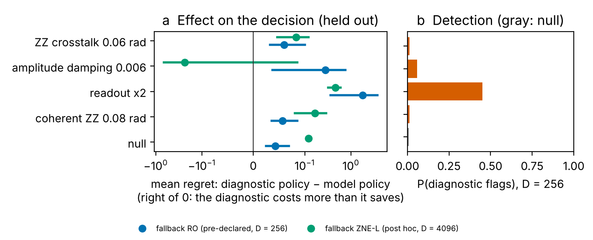

# Diagnostic-conditioned QEM decisions — supporting study (EMULATION)

Simulation only: no hardware data. Budget B = 20,000 shots per estimate; a diagnostic of D shots of the unmitigated target circuit (D chosen on the exploration cases from 256, 1024, 4096), TVD check at α = 0.01; the conditioned policy estimates with B − D. Regret = RMSE / RMSE of the best protocol under the truth at B − 1; harmful = worse than unmitigated by more than 10 %; expectations over the flag.

## Fallback RO — primary (pre-declared fallback) (D = 256)

### Held-out circuits and mismatch types

| scenario | cases (circuits) | P(flag) | model policy: regret / harmful | diagnostic policy: regret / harmful | fallback always: regret / harmful | diagnostic − model regret [95 % CI over circuits] |
|---|---|---|---|---|---|---|
| ZZ crosstalk 0.06 rad | 5 (5) | 0.013 | 0.0236 / 0 | 0.0832 / 0 | 4.19 / 0 | 0.0596 [0.0326, 0.101] |
| amplitude damping 0.006 | 5 (5) | 0.06 | 0.462 / 0 | 0.743 / 0 | 3.72 / 0 | 0.281 [0.0371, 0.755] |
| coherent ZZ 0.08 rad | 5 (5) | 0.014 | 0.0501 / 0 | 0.106 / 0 | 4.22 / 0 | 0.0563 [0.0356, 0.0856] |
| null | 5 (5) | 0.008 | 0 / 0 | 0.0429 / 0 | 4.38 / 0 | 0.0429 [0.0245, 0.0692] |
| readout x2 | 5 (5) | 0.45 | 0 / 0 | 1.77 / 0 | 3.25 / 0 | 1.77 [0.365, 3.75] |

### Exploration cases (every D)

| D | mismatch | cases | P(flag) | model regret | diagnostic regret | diagnostic − model [95 % CI] |
|---|---|---|---|---|---|---|
| 256 | False | 4 | 0.0091 | 0 | 0.038 | 0.038 [0.0252, 0.0508] |
| 256 | True | 4 | 0.032 | 0.742 | 0.856 | 0.114 [0.0254, 0.285] |
| 1024 | False | 4 | 0.0089 | 0 | 0.0546 | 0.0546 [0.0472, 0.062] |
| 1024 | True | 4 | 0.11 | 0.742 | 1.15 | 0.41 [0.0418, 1.12] |
| 4096 | False | 4 | 0.011 | 0 | 0.154 | 0.154 [0.141, 0.168] |
| 4096 | True | 4 | 0.29 | 0.742 | 1.82 | 1.07 [0.134, 2.88] |

## Fallback ZNE-L — post hoc sensitivity (D = 4096)

### Held-out circuits and mismatch types

| scenario | cases (circuits) | P(flag) | model policy: regret / harmful | diagnostic policy: regret / harmful | fallback always: regret / harmful | diagnostic − model regret [95 % CI over circuits] |
|---|---|---|---|---|---|---|
| ZZ crosstalk 0.06 rad | 5 (5) | 0.069 | 0.0236 / 0 | 0.107 / 0 | 0.374 / 0 | 0.0834 [0.0466, 0.12] |
| amplitude damping 0.006 | 5 (5) | 0.43 | 0.462 / 0 | 0.224 / 0 | 0.187 / 0 | -0.238 [-0.664, 0.0856] |
| coherent ZZ 0.08 rad | 5 (5) | 0.17 | 0.0501 / 0 | 0.216 / 0 | 0.481 / 0 | 0.165 [0.0812, 0.292] |
| null | 5 (5) | 0.0097 | 0 / 0 | 0.12 / 0 | 0.397 / 0 | 0.12 [0.115, 0.125] |
| readout x2 | 5 (5) | 0.84 | 0 / 0 | 0.459 / 0 | 0.383 / 0 | 0.459 [0.32, 0.598] |

### Exploration cases (every D)

| D | mismatch | cases | P(flag) | model regret | diagnostic regret | diagnostic − model [95 % CI] |
|---|---|---|---|---|---|---|
| 256 | False | 4 | 0.0091 | 0 | 0.00962 | 0.00962 [0.008, 0.0116] |
| 256 | True | 4 | 0.032 | 0.742 | 0.708 | -0.0345 [-0.0945, -0.00216] |
| 1024 | False | 4 | 0.0089 | 0 | 0.0288 | 0.0288 [0.0265, 0.031] |
| 1024 | True | 4 | 0.11 | 0.742 | 0.616 | -0.126 [-0.373, 0.00244] |
| 4096 | False | 4 | 0.011 | 0 | 0.12 | 0.12 [0.116, 0.125] |
| 4096 | True | 4 | 0.29 | 0.742 | 0.444 | -0.299 [-0.908, 0.0267] |

## Reading

* Under the null the diagnostic can only cost: it spends D shots and flags at about the size α.
* It can help only where a mismatch both makes the model's choice worse than the fallback *and* is visible in the unmitigated output distribution at D shots. A mismatch that the check does not see, or that does not change the decision, leaves only the cost — and a flag that switches to a worse fallback adds loss.
* Decision relevance: the unmitigated-distribution check is most sensitive to readout errors, which the protocols' own measured calibration already corrects, and least sensitive to the gate-rate errors that bias the model-dependent PEC inverse. A diagnostic aimed at the inputs of the decision (for example the gate-error rate the PEC inverse assumes, estimated from readout-corrected mirror circuits) is the natural next design; it is a proposal here, not a tested result.
* The second analysis changed the fallback after the first was seen. It is a sensitivity analysis, not a confirmed result; a confirmation needs new circuits and mismatch types.
* The circuits, the mismatch strengths and the single statistic are a small designed set: these numbers are evidence about this design, not a general property of discrepancy diagnostics.
