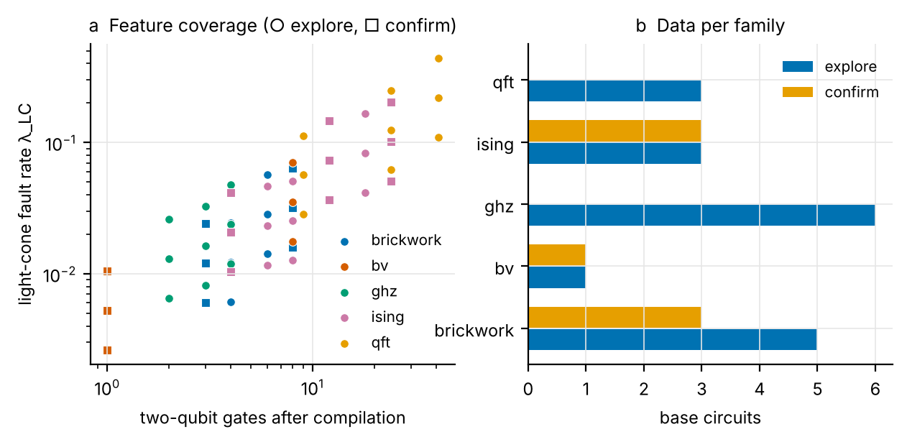
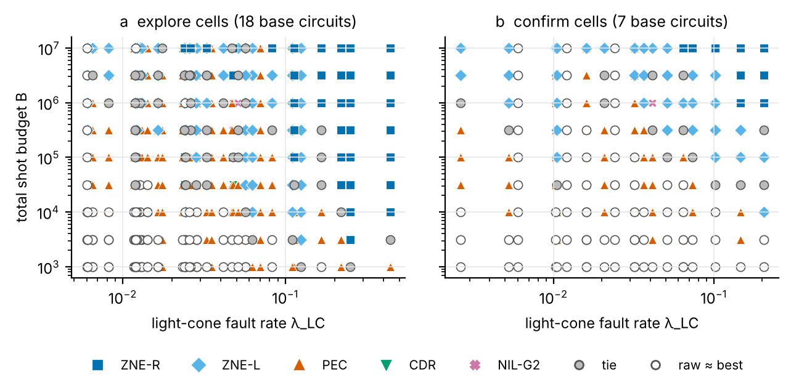
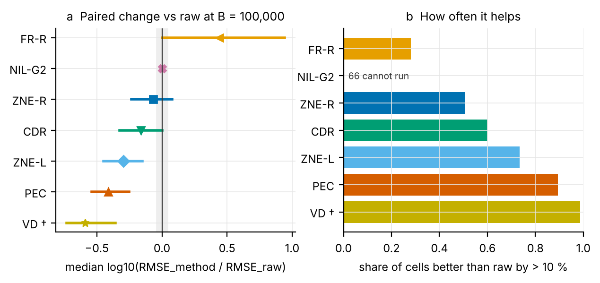
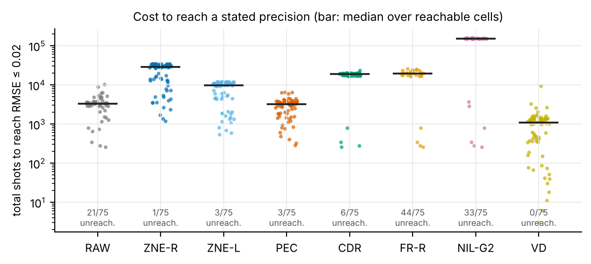
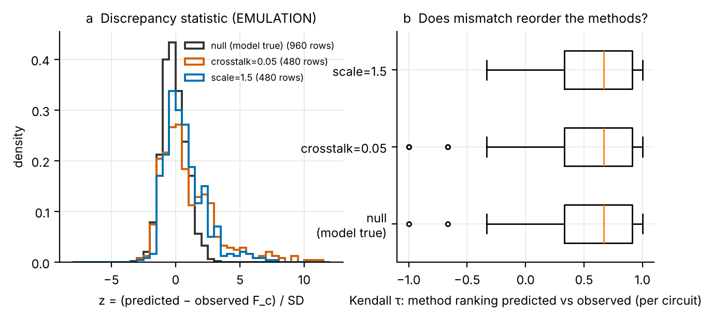
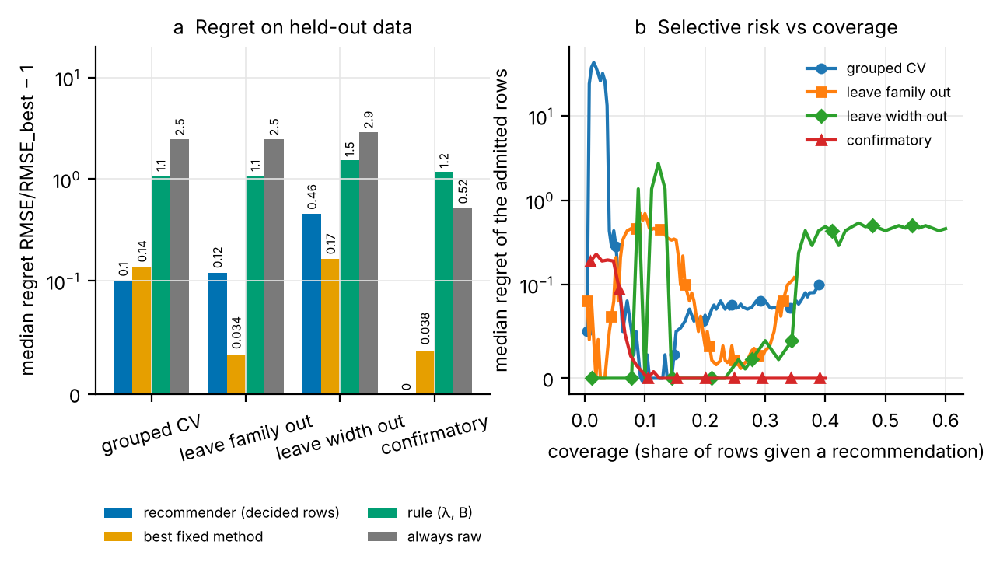

# Main-study figure report — direction-A-v2-pilot

Simulation study on the device model named in the manifest (no hardware data in figures 1–4 and 6; figure 5 is an EMULATION rehearsal). 75 cells from 25 base circuits (18 explore / 7 confirm base circuits, split by hash before any outcome). Resource: the total shot budget B of one estimate (training, calibration and every extra circuit included), allocated by the equal-budget ledger (policy *fixed*). Outcome: RMSE against the exact ideal value. Intervals: 95 % bootstrap over base circuits. Practical equivalence δ = 10 % in RMSE.

† Upper bounds, never candidates: VD (flag `optimistic`: simulated with ideal resources, e.g. virtual distillation with ideal copies, an ideal derangement and ideal readout). They appear in Figures 3–4 for reference and are excluded from the regime maps and the recommender.

Approximation flags present in the records: `calibration-mean-first-order`, `degenerate`, `gaussian-sampler`, `nonlinear`, `optimistic`.

## Figure 1 — Feature coverage

(a) Compiled two-qubit count against the light-cone fault rate λ_LC per cell (○ explore, □ confirmatory). (b) Base circuits per family and split. Regions without points are not covered: no figure below extrapolates into them.

## Figure 2 — Empirical performance-regime map

Each point is one cell at one budget of the grid (no interpolation), colored by the best method; gray: a tie within δ; white: raw within δ of the best (no demonstrated benefit); black: no method can run at that budget. (a) exploration cells, (b) confirmatory cells. Regime shares:

| regime | share of (cell, B) points |
|---|---|
| PEC | 0.396 |
| raw ≈ best | 0.235 |
| ZNE-L | 0.182 |
| tie | 0.095 |
| ZNE-R | 0.059 |
| NIL-G2 | 0.019 |
| CDR | 0.014 |

## Figure 3 — Paired change against raw

(a) Median over cells of log10(RMSE_method / RMSE_raw) at B = 100,000 with 95 % base-circuit bootstrap intervals; the gray band is ±δ. (b) Share of cells in which the method is better than raw by more than δ; methods that cannot run at this budget are counted, not dropped.

| method | cells | median log10 ratio [95 % CI] | median absolute RMSE gain [95 % CI] | share better | cannot run |
|---|---|---|---|---|---|
| ZNE-R | 75 | -0.068 [-0.235, 0.0795] | 0.00149 [-0.00179, 0.00591] | 0.51 | 0 |
| ZNE-L | 75 | -0.296 [-0.45, -0.151] | 0.00484 [0.00227, 0.00948] | 0.73 | 0 |
| PEC | 75 | -0.412 [-0.539, -0.252] | 0.00541 [0.00299, 0.00933] | 0.89 | 0 |
| CDR | 75 | -0.161 [-0.324, 0] | 0.00266 [0, 0.00659] | 0.6 | 0 |
| FR-R | 75 | 0.443 [0, 0.942] | -0.0252 [-0.0726, 0] | 0.28 | 0 |
| NIL-G2 | 9 | 0 [0, 0] | 0 [0, 0] | 0 | 66 |
| VD | 75 | -0.591 [-0.732, -0.358] | 0.00726 [0.0046, 0.0102] | 0.99 | 0 |

## Figure 4 — Cost to reach a stated precision

Smallest total budget at which RMSE ≤ 0.02, per cell (points) and its median over reachable cells (bar). 'Unreachable' cells have a bias floor above 0.02 at any budget: more shots cannot fix them.

## Figure 5 — Discrepancy diagnostics and method rankings (EMULATION, not hardware)

End-to-end rehearsal of the hardware path on emulated observations of the divergence suite: (a) the discrepancy statistic z when the truth is the predictor's own model (null) and under controlled unmodeled effects; (b) per circuit, Kendall τ between the ordering of the four methods by predicted and by observed classical fidelity F_c (Chen et al. Eq. 1, unnormalized). Under the null, Holm-adjusted flags: 0 of 1120 rows; unadjusted |z| > 3: 2.

## Figure 6 — Baseline recommender on held-out data

Ridge models of log10 RMSE per method from recommendation-time features (n, two_qubit_logical, non_clifford, two_qubit, depth, obs_weight, lam_lc, lam_ro, scale, coherent_fraction, log10_budget), fitted inside each training fold. Folds group every row of a base circuit; leave-family-out and leave-width-out test transfer; the confirmatory subset was fixed before any outcome. (a) Median regret (RMSE_chosen / RMSE_best − 1) of the recommender on the rows where it decided, and of the baselines on all rows. (b) Selective risk: regret as rows are admitted from the most to the least confident.

| evaluation | feature set | rows | coverage | recommends raw (raw truly within δ) | accuracy (in δ set) | median regret | vs fixed on decided rows | interval coverage (90 %) | fixed-method regret | rule regret | raw regret |
|---|---|---|---|---|---|---|---|---|---|---|---|
| grouped cv | structural | 270 | 0.4 | 0.35 (0.52) | 0.5 | 0.0996 | 0.0991 | 0.84 | 0.138 | 1.09 | 2.45 |
| leave family out | structural | 270 | 0.35 | 0.074 (0.65) | 0.49 | 0.12 | 0.115 | 0.23 | 0.0339 | 1.09 | 2.45 |
| leave width out | structural | 90 | 0.6 | 0.57 (0.33) | 0.37 | 0.46 | 0.459 | 0.89 | 0.165 | 1.52 | 2.89 |
| confirmatory | structural | 105 | 0.4 | 0.37 (0.82) | 0.79 | 0 | -0.0313 | 0.88 | 0.0375 | 1.17 | 0.524 |
| grouped cv | normalized | 270 | 0.36 | 0.35 (0.52) | 0.53 | 0.0748 | 0.0724 | 0.86 | 0.138 | 1.09 | 2.45 |
| leave family out | normalized | 270 | 0.51 | 0.14 (0.65) | 0.47 | 0.166 | 0.119 | 0.6 | 0.0339 | 1.09 | 2.45 |
| leave width out | normalized | 90 | 0.6 | 0.43 (0.31) | 0.43 | 0.183 | 0.179 | 0.74 | 0.165 | 1.52 | 2.89 |
| confirmatory | normalized | 105 | 0.42 | 0.41 (0.77) | 0.77 | 0 | -0.0175 | 0.86 | 0.0375 | 1.17 | 0.524 |
| grouped cv | with_state | 270 | 0.4 | 0.33 (0.51) | 0.53 | 0.0868 | 0.0834 | 0.76 | 0.138 | 1.09 | 2.45 |
| leave family out | with_state | 270 | 0.43 | 0.2 (0.53) | 0.55 | 0.0499 | 0.0499 | 0.28 | 0.0339 | 1.09 | 2.45 |
| leave width out | with_state | 90 | 0.66 | 0.31 (0.29) | 0.41 | 0.178 | 0.144 | 0.51 | 0.165 | 1.52 | 2.89 |
| confirmatory | with_state | 105 | 0.43 | 0.4 (0.83) | 0.78 | 0 | -0.0296 | 0.78 | 0.0375 | 1.17 | 0.524 |

Feature weights of these models are associations within the sampled design, not causes. A recommendation outside the training coverage is withheld ('abstain-coverage').

## Limits of this report

* Simulation on one device model; the hardware transfer test is a separate, budgeted campaign (docs/hardware_preflight.md). No hardware result is shown here.
* A pilot: few base circuits per family. Intervals are wide by design; read them, not the point estimates.
* Learning methods' RMSE includes their training-level Monte Carlo terms; that Monte-Carlo error is not propagated into the intervals above.
